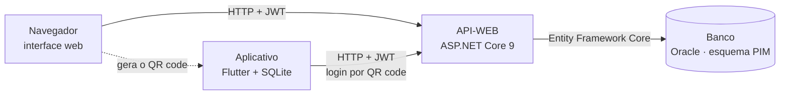

# Sistema White Label

Sistema de gestão comercial para estabelecimentos de **compra e revenda** (mercados, distribuidores e comércios de bairro), com **API**, **interface web** e **aplicativo mobile**. Foi pensado como produto **white label**: um sistema genérico o bastante para ser adaptado e revendido a diferentes comércios, em que as funcionalidades que nem todo negócio usa são **módulos que se ligam e se desligam**.

> Projeto Integrador Multidisciplinar (PIM) do **4º semestre** do curso de Análise e Desenvolvimento de Sistemas – **UNIP**, Assis/SP, 2026.

## Objetivo

Muitos pequenos comércios ainda controlam estoque, compras, vendas e contas a receber no papel. Isso gera falhas de controle, perda de informação e dificulta decisões. O objetivo do projeto é oferecer uma ferramenta **acessível, segura e adaptável** que centralize essa gestão:

- controlar **produtos e estoque**, com alerta de estoque mínimo;
- registrar **vendas** (dinheiro, Pix e cartão) e emitir **recibo em PDF**;
- acompanhar **clientes**, **vendas a prazo** e **compras de fornecedores**;
- gerar **relatórios** de fechamento por período, com valores brutos e líquidos;
- proteger o acesso com **autenticação em dois fatores** e **perfis de permissão**;
- permitir o uso no **celular**, conectado ao sistema por **QR code**.

## Divisão do repositório

```
PIM-4-SEMESTRE
├── API-WEB    API em ASP.NET Core 9 + interface web (HTML, CSS e JavaScript)
├── Banco      Scripts SQL do banco Oracle (tabelas, views e procedures)
├── API-APP    Aplicativo mobile em Flutter
└── README.md  este arquivo
```

| Pasta | O que tem | Tecnologias |
|---|---|---|
| [`API-WEB`](API-WEB) | Regras de negócio, rotas REST, autenticação (JWT + TOTP), módulos, recibos em PDF e as telas web servidas pela própria API | C#, ASP.NET Core 9, Entity Framework Core, QuestPDF, HTML5, CSS, JavaScript |
| [`Banco`](Banco) | Scripts numerados que criam e ajustam o esquema `PIM`: tabelas `tb_`, views `sv_`, módulos e dados iniciais | Oracle, SQL e PL/SQL |
| [`API-APP`](API-APP) | App para controle de estoque e cadastro de produtos, com banco local e sincronização com a API | Flutter, Dart, SQLite (`sqflite`) |

Cada pasta tem o seu próprio `README.md` com o passo a passo.

## Como as partes se conectam



- A API serve as páginas web e atende o aplicativo; o único componente que conversa com o banco é a API.
- O celular não digita senha: o sistema web gera um **QR code** (vale 2 minutos, uso único) e o aplicativo troca o código por uma sessão de 3 dias, renovável até 30 dias e revogável pelo sistema.

## Principais funcionalidades

- **Login em duas etapas:** senha e código TOTP de um aplicativo autenticador
- **Perfis:** Administrador, Gerente e Vendedor, com telas e permissões diferentes
- **Vendas (PDV)**, histórico, dashboard por período e recibo em PDF
- **Produtos, categorias e estoque** com estoque mínimo por produto
- **Clientes**
- **Módulo A prazo:** vendas a prazo e valores a receber
- **Módulo Fornecedor:** cadastro de fornecedores e compras, com entrada automática no estoque
- **Aplicativo mobile:** estoque e cadastro de produtos, com banco local e sincronização

Os módulos **A prazo** e **Fornecedor** são ligados e desligados pelo Administrador em *Configurações*. Com o módulo desligado, a API responde como se as rotas não existissem e o menu deixa de mostrar as telas.

## Como rodar (resumo)

1. **Banco:** com o Oracle no ar (serviço `XEPDB1`, usuário `PIM`), rode os scripts da pasta [`Banco`](Banco) na ordem indicada no README dela.
2. **API e web:** em [`API-WEB`](API-WEB), configure a conexão no `appsettings.json` e execute `dotnet run --launch-profile https`. Abra `http://IP-DO-COMPUTADOR:5012`.
3. **Aplicativo:** em [`API-APP`](API-APP), rode `flutter pub get` e `flutter run`. No sistema web, vá em *Configurações → Conectar celular* e leia o QR code com o aplicativo.

O computador e o celular precisam estar na mesma rede (ou em uma VPN), e o sistema deve ser aberto pelo **IP da rede**, não por `localhost`.

## Disciplinas do semestre no projeto

| Disciplina | Onde aparece |
|---|---|
| Programação de Banco de Dados | `Banco`: modelo relacional, views e procedures |
| Programação Aplicada em .NET | `API-WEB`: camadas Controller → Service → DbContext, DTOs, injeção de dependência, EF Core, JWT |
| Desenvolvimento Web com .NET | `API-WEB/wwwroot`: interface responsiva servida pela API |
| Desenvolvimento Mobile | `API-APP`: aplicativo Flutter com SQLite e login por QR code |
| Gerenciamento de Projetos Ágil | Entregas incrementais, quadro de tarefas e este repositório |
| Cloud Computing e DevOps | API sem estado de sessão, preparada para a nuvem; CI/CD e contêineres previstos |
| Empreendedorismo em TI | Modelo white label, controle de estoque e relatórios financeiros |
| Relações Étnico-Raciais e Afrodescendência | Inclusão, acesso por pequenos comércios e proteção de dados pessoais |

## Status e próximos passos

O sistema foi validado em ambiente de desenvolvimento, em rede local, e ainda não passou por um piloto em um comércio real.

- [ ] Procedures de registro de venda e de recebimento de compra no banco
- [ ] Guardar as senhas com hash (hoje são comparadas em texto puro)
- [ ] Fila de envio no aplicativo para alterações feitas sem conexão
- [ ] Testes automatizados e pipeline de CI/CD
- [ ] Conteinerização da API
- [ ] Piloto em um comércio real

## Equipe

- Gabriel Kubota Marcheti
- Yasmin Gabrielly de Oliveira Francisco
- Matheus Freitas Fernandes

UNIP – Assis/SP, 2026.
